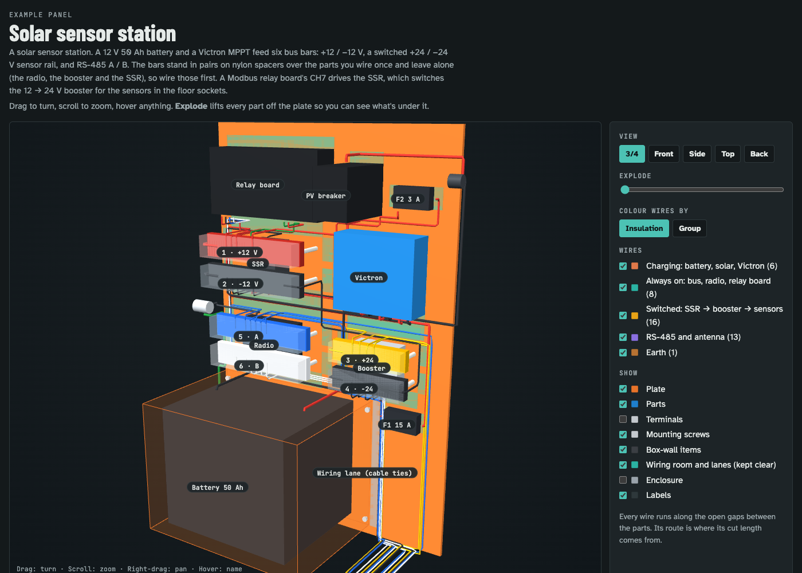
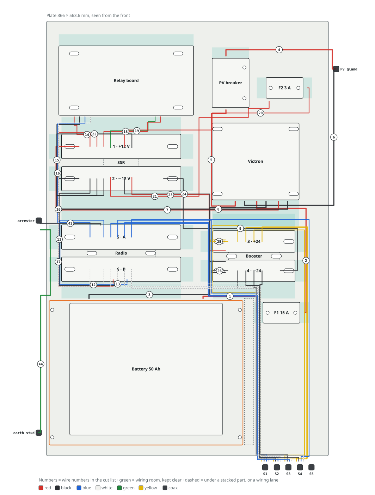
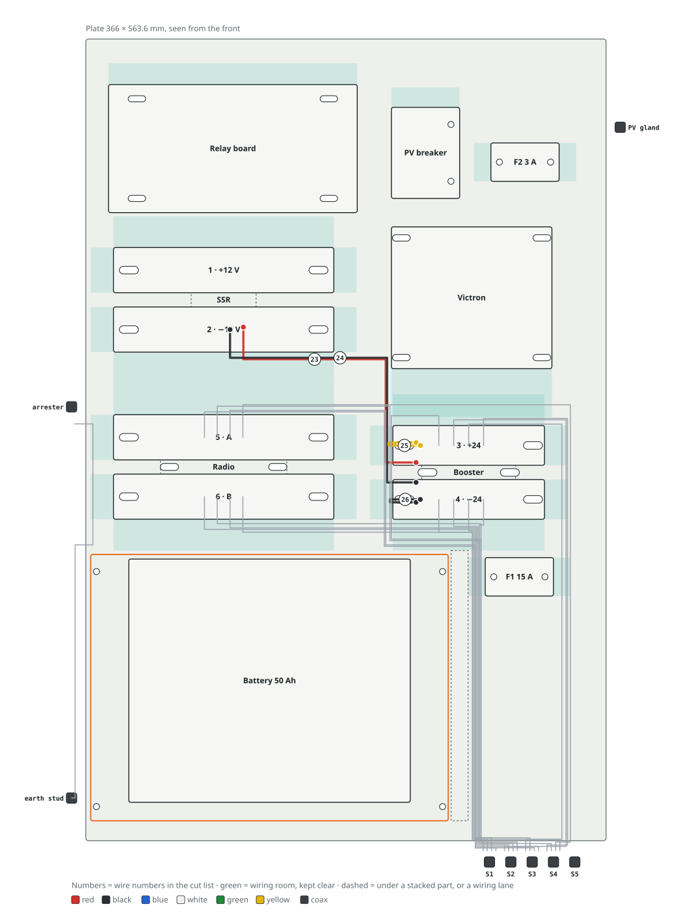

# panel-visualizer

A [Claude Code](https://claude.com/claude-code) skill that turns a list of parts and wires into an interactive page for
an electrical backplate or control panel.



From one JSON spec, it builds:

- **a 3-D model**: orbit, five views, an Explode slider, hover names, and switches for wire groups and layers;
- **auto-routed wires**: every wire runs through the gaps between parts (never over a device), in its insulation colour;
- **the plate seen from the front**, with every wire on its route and numbered;
- **a step-by-step wiring guide**: one picture per step, with tick boxes;
- **a cut list** with lengths taken from the routes, plus "wire to buy" totals (HTML, CSV, Markdown);
- **layout checks**: parts that collide, sit closer than your clearance, run off the plate, or block another part's
  wiring room.

The output is a single HTML file. Open it from disk or put it on any static host.

## Install

In Claude Code:

```
/plugin marketplace add Parth-Rearden/panel-visualizer
/plugin install panel-visualizer@panel-visualizer
```

Or copy the skill folder by hand:

```bash
git clone https://github.com/Parth-Rearden/panel-visualizer
cp -r panel-visualizer/skills/panel-visualizer ~/.claude/skills/      # for every project
```

## Use it

Open `/skills` and you'll see it listed. Invoke it by name, or just describe your panel:

> Lay out my 24 V control panel: a 55 × 90 power supply, a 2-pole breaker, a PLC with I1–I2 and Q1–Q2, two relays and
> + / 0 V bus bars on a 400 × 300 plate. Give me a cut list.

Claude writes the spec, runs the checks, fixes the layout until they pass, builds the page and looks at it.

## Use it without Claude

Python 3.8+, standard library only.

```bash
cd skills/panel-visualizer
python3 scripts/build_panel.py --init my-panel.json    # start from the minimal example
python3 scripts/build_panel.py my-panel.json --check   # checks and routing only, no files
python3 scripts/build_panel.py my-panel.json           # → my-panel-build/my-panel.html
python3 scripts/build_panel.py my-panel.json --wires   # the cut list as a Markdown table
```

A part, a bus bar and a wire look like this:

```jsonc
// a part with a row of terminals along its top edge
{ "id": "relay", "name": "Relay module, 1 channel", "label": "Relay", "x": 130, "y": 30, "w": 50, "h": 40, "d": 20,
  "strips": [{ "edge": "top", "names": ["+", "-", "IN1"], "start": 10, "pitch": 12 }] }

// a bus bar: terminals A, B (studs) and 1–6 (screws)
{ "id": "bar_pos", "name": "Bus bar +12 V", "x": 110, "y": 160, "w": 110, "h": 25, "d": 20,
  "busbar": { "screws": 6, "pitch": 12, "studs": 45, "lugs": "up" } }

// a wire, from part.terminal to part.terminal
{ "from": "bar_pos.2", "to": "relay.+", "gauge": "20 AWG", "colour": "red", "group": "control" }
```

Every field is in [`references/spec.md`](skills/panel-visualizer/references/spec.md).

| Wiring on the plate | One wiring step |
|---|---|
|  |  |

## Examples

| Spec | What it shows |
|---|---|
| [`minimal.json`](skills/panel-visualizer/examples/minimal.json) | A 12 V pump controller: fuse, two bus bars, controller, relay and two glands. 11 wires |
| [`solar-sensor-station.json`](skills/panel-visualizer/examples/solar-sensor-station.json) | A solar sensor station (pictured): a battery in a tray, an MPPT, six bus bars stacked on spacers over other parts, a Modbus relay board, an SSR switching a 24 V sensor rail, and floor sockets. 44 wires |

## How the routing works

A channel runs through every gap: one just off each side of every part, a ring around the plate's edge, and the
middle of any wiring lane you declare. Each wire leaves its terminal in the direction you give it, takes the shortest
path along the channels (with a cost for each bend), and goes straight into the terminal at the other end. Parallel
runs are nudged apart. Cut length is the 3-D route, plus slack, plus an allowance for both terminations.

## Repository layout

```
.claude-plugin/          plugin and marketplace manifests
skills/panel-visualizer/
  SKILL.md               what Claude follows
  scripts/build_panel.py checks, routing, 3-D scene, diagrams and cut list
  assets/page.html       the page template
  references/spec.md     every spec field
  examples/              two specs to copy from
tests/                   python3 -m unittest discover -s tests
```

## Contributing

Issues and pull requests are welcome. Run the tests before sending a change, and rebuild both examples and look at the
pages if you touched the routing or the template.

## License

MIT
